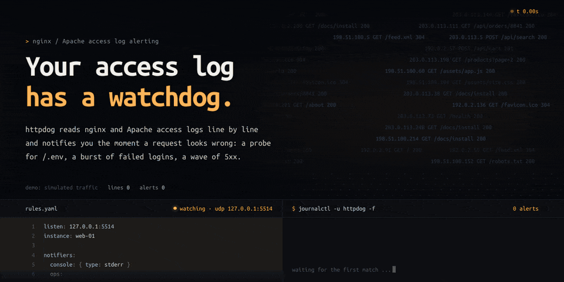

# httpdog

[](https://github.com/guanting112/httpdog/actions/workflows/build.yml)
[](https://github.com/guanting112/httpdog/releases/latest)
[](LICENSE)
[](https://github.com/guanting112/httpdog/attestations)
[](https://scorecard.dev/viewer/?uri=github.com/guanting112/httpdog)
[](#2-install-on-ubuntu)

English | [繁體中文](README.zh-TW.md)



Watches your website's access log and notifies you when it sees suspicious or abnormal requests.

For example:

- Someone is scanning for sensitive files such as `/.env` or `/.git/config`
- The same IP fails to log in 20 times within a minute
- The site suddenly returns a lot of 5xx, or some pages become very slow

You describe what should trigger a notification in a rule file. httpdog matches every log line nginx / Apache sends against it and notifies you on a match.

```
nginx / Apache ──a log line per request──▶ httpdog (matches the rules) ──▶ notification: your webhook URL, or the system log
```

- **Light**: a single binary (about 4 MB) using about 5 MB of memory when idle, with no database or other service to run
- **Easy to install**: releases ship amd64 and arm64 binaries that run as downloaded, no Rust needed
- **Works without touching the web server config**: reads the default log format of nginx / Apache
- **No restart to change rules**: `systemctl reload` applies them; a broken new rule file keeps the old rules, so monitoring never stops
- **Notifications never slow down log intake**: a dead webhook does not affect matching

It only matches and notifies. It does not store logs and has no query interface; to look back through old logs, use a tool such as Loki or Graylog.

## Contents

1. [Try it first](#1-try-it-first)
2. [Install on Ubuntu](#2-install-on-ubuntu)
3. [Feed it logs](#3-feed-it-logs)
4. [Write rules](#4-write-rules)
5. [Receive notifications](#5-receive-notifications)
6. [Day-to-day operations](#6-day-to-day-operations)
7. [Troubleshooting](#7-troubleshooting)

Also: [Command line](#command-line), [More documentation](#more-documentation), [Development](#development)

## 1. Try it first

No nginx needed: download the binary from the latest release, replay the bundled `sample.log` and watch the rules fire. The binaries are for Linux on amd64 and arm64; on anything else, [build it from source](#building-from-source).

```bash
# The binary, from the latest release. dpkg prints amd64 or arm64;
# without dpkg, set ARCH by hand (uname -m: x86_64 is amd64, aarch64 is arm64)
ARCH=$(dpkg --print-architecture)
curl -fsSLo httpdog "https://github.com/guanting112/httpdog/releases/latest/download/httpdog-linux-$ARCH"
chmod +x httpdog

# The example rule file and a sample log, from the same version as the binary
RAW="https://raw.githubusercontent.com/guanting112/httpdog/v$(./httpdog --version | cut -d' ' -f2)"
curl -fsSLO "$RAW/rules.example.yaml"
curl -fsSLO "$RAW/sample.log"

# The example rules send alerts to a webhook. Without a receiver yet, use a dummy URL and secret
export HTTPDOG_WEBHOOK_URL=http://127.0.0.1:9/dummy
export HTTPDOG_WEBHOOK_SECRET=dummy

./httpdog --check --config rules.example.yaml          # Check the rule file for mistakes
./httpdog --stdin --config rules.example.yaml < sample.log
```

Expected output:

```
httpdog started: 4 rule(s), reading from stdin
ALERT [httpdog] sensitive-file-probe | 203.0.113.7 tried to access /.env (status 404) | remote_addr=203.0.113.7
ALERT [httpdog] slow-request | /report/monthly took 7.31s
ALERT [httpdog] sensitive-file-probe | 192.0.2.44 tried to access /backup/db.sql (status 404) | remote_addr=192.0.2.44
done: 6 lines, 0 unparseable, 3 alerts fired
```

Each `ALERT` line is one notification. In `sample.log` the first IP goes on to probe `/.git/config`, but that IP was just notified (it is still in its cooldown), so there is no second notification.

With the dummy URL, each `ALERT` is followed by a few `webhook attempt N failed` lines and the whole run takes about 9 seconds. That is expected: the URL is fake, so nothing can be delivered.

**To test your own webhook receiver at the same time**, set the two environment variables to the real URL and secret and run it again. The receiver gets these 3 alerts and no failure lines appear. If you have no receiver yet, start one locally from the example in [docs/webhook.md](docs/webhook.md#receiver-example).

## 2. Install on Ubuntu

Every [release](https://github.com/guanting112/httpdog/releases) ships prebuilt binaries for amd64 and arm64. They need no Rust and run on any Ubuntu version.

```bash
# 1. The binary, from the latest release. dpkg prints amd64 or arm64
ARCH=$(dpkg --print-architecture)
curl -fsSLO "https://github.com/guanting112/httpdog/releases/latest/download/httpdog-linux-$ARCH"
curl -fsSLO https://github.com/guanting112/httpdog/releases/latest/download/SHA256SUMS
sha256sum --check --ignore-missing SHA256SUMS      # Should print httpdog-linux-...: OK
sudo install -m 755 "httpdog-linux-$ARCH" /usr/local/bin/httpdog
httpdog --version

# 2. The example rule file and the systemd unit, from the same version as the binary
RAW="https://raw.githubusercontent.com/guanting112/httpdog/v$(httpdog --version | cut -d' ' -f2)"
curl -fsSLO "$RAW/rules.example.yaml"
curl -fsSLO "$RAW/deploy/httpdog.service"
sudo install -d /etc/httpdog
sudo install -m 644 rules.example.yaml /etc/httpdog/rules.yaml

# 3. Secrets (the webhook URL and secret), readable by root only
sudo install -m 600 /dev/null /etc/httpdog/secrets.env
sudoedit /etc/httpdog/secrets.env      # Add HTTPDOG_WEBHOOK_URL=https://<your receiver>/...
                                       # and HTTPDOG_WEBHOOK_SECRET=<a value from openssl rand -hex 32>

# 4. Hand it to systemd
sudo install -m 644 httpdog.service /etc/systemd/system/
sudo systemctl daemon-reload
sudo systemctl enable --now httpdog
systemctl status httpdog
```

Notes:

- To install a specific version instead of the latest, replace `latest/download` with `download/v0.1.0` in both URLs of step 1.
- `SHA256SUMS` only catches a corrupted download, because it sits next to the binaries. To prove that a binary was built by this repository's workflow, verify its signed build provenance. Each release carries it as `httpdog.sigstore.json`, so `gh` needs no GitHub login:

  ```bash
  curl -fsSLO https://github.com/guanting112/httpdog/releases/latest/download/httpdog.sigstore.json
  gh attestation verify "httpdog-linux-$ARCH" -R guanting112/httpdog --bundle httpdog.sigstore.json
  ```

- The service needs no account created in advance (the unit file uses `DynamicUser`). systemd reads `secrets.env` as root before dropping privileges, so the service itself cannot touch that file.
- The rule templates under `examples/` are in the repository, not in the release: `git clone`, or download the Source code archive on the release page.

### Building from source

For a system the release has no binary for, or to run your own changes. Rust 1.85 or later is needed.

```bash
git clone https://github.com/guanting112/httpdog.git && cd httpdog
cargo build --release
./target/release/httpdog --version
```

To install that build, use `sudo install -m 755 target/release/httpdog /usr/local/bin/` in place of step 1 above; `rules.example.yaml` and `deploy/httpdog.service` are already in the clone.

## 3. Feed it logs

httpdog understands two log formats. Pick one:

| | Option 1: the default format (`combined`) | Option 2: JSON |
|---|---|---|
| What changes on the web server | nginx gets one line | nginx gets a `log_format` block |
| Fields rules can use | A fixed 12, without the site name (`host`) and the processing time (`request_time`) | You decide; add whatever you want to match |
| Good for | Trying it out; Apache | Long-term use; rules such as slow requests or grouping by site |

### Option 1: the default format (combined)

The default access log of nginx and Apache looks like this, and httpdog reads it directly:

```
203.0.113.7 - - [11/Nov/2026:13:50:01 +0800] "GET /.env HTTP/1.1" 404 153 "-" "curl/8.5.0"
```

1. Write `format: combined` at the top of the rule file. `examples/00-combined-starter.yaml` is a starter rule file that works as it is.
2. Replay an existing log first; nothing needs to change:

   ```bash
   httpdog --stdin --config examples/00-combined-starter.yaml < /var/log/nginx/access.log
   ```

3. For live monitoring, add one line inside nginx's `http { }`, then run `sudo nginx -t && sudo systemctl reload nginx`:

   ```nginx
   access_log syslog:server=127.0.0.1:5514,tag=nginx,nohostname;
   ```

Apache connects differently; see [docs/log-format.md](docs/log-format.md#apache).

### Option 2: JSON

Put the contents of `deploy/nginx-snippet.conf` inside nginx's `http { }`, then run `sudo nginx -t && sudo systemctl reload nginx`:

```nginx
log_format httpdog escape=json
    '{"remote_addr":"$remote_addr",'
    '"host":"$host",'
    '"request_method":"$request_method",'
    '"uri":"$uri",'
    '"request_uri":"$request_uri",'
    '"status":$status,'
    '"request_time":$request_time,'
    '"body_bytes_sent":$body_bytes_sent,'
    '"http_referer":"$http_referer",'
    '"http_user_agent":"$http_user_agent"}';

access_log syslog:server=127.0.0.1:5514,tag=nginx,nohostname httpdog;
```

**The field names in rules are the JSON keys here.** To match something else, add a key to `log_format` and rules can use it.

### Notes for both options

- An existing `access_log` that writes to a file can stay; several `access_log` lines may sit at the same level.
- When the site is behind Cloudflare or another reverse proxy, set up nginx's `real_ip` first. Otherwise every log line has the proxy's IP as its source, and "each IP counted separately" turns into everyone counted together.

For the content and type of each field and what to watch out for, see [docs/log-format.md](docs/log-format.md).

## 4. Write rules

The rule file is a YAML file (JSON works too); a complete example is in `rules.example.yaml`. The one below has a single rule: **notify when the same IP fails to log in 20 times within 60 seconds**.

```yaml
instance: web-01                  # Name of this httpdog instance; notifications carry it

notifiers:                        # Where notifications can go
  console:
    type: stderr                  # Writes to the system log; start with this while testing rules
  ops:
    type: webhook                 # Sends to your own receiver
    url_env: HTTPDOG_WEBHOOK_URL
    secret_env: HTTPDOG_WEBHOOK_SECRET

rules:
  - id: login-bruteforce          # Name of the rule
    when:                         # Condition: all three of these hold
      all:
        - { field: uri, op: prefix, value: /login }
        - { field: request_method, op: eq, value: POST }
        - { field: status, op: in, value: [401, 403] }
    group_by: remote_addr         # Each IP is counted separately
    threshold: { count: 20, window: 60s }   # Notify only after 20 hits within 60 seconds
    cooldown: 10m                 # After notifying, stay quiet about the same IP for 10 minutes
    notify: [console, ops]        # Which notifiers to send to
    message: "{remote_addr} repeated login failures"
```

A rule is made of these parts:

| Key | Purpose |
|---|---|
| `when` | The condition. Each item says which log field to look at, how to compare and what to compare with. Combine them with `all` (every one holds), `any` (at least one holds) and `not` (negation) |
| `threshold` | How many hits within a period before notifying. Without it, a single hit notifies |
| `group_by` | Grouping: thresholds and cooldowns are tracked separately per value of this field, e.g. each IP on its own |
| `cooldown` | After a notification, the same group stays quiet for this long. 1 minute when not set |
| `notify` | Which notifiers to send to |
| `message` | The notification text; `{field}` is replaced with that log line's value |

Comparisons include equality, prefix, suffix, contains, regular expressions and numeric comparison. The full list and the details are in [docs/rules.md](docs/rules.md).

### Ready-made rule templates

There are 6 rule files under `examples/`. Each is a complete config that loads as it is, and the comments at the top say who it is for and what to change before using it.

| File | Scenario | What it catches |
|---|---|---|
| `00-combined-starter.yaml` | Starter (`combined` format) | 8 general rules that work without changing the log format. Writes to the system log only; no webhook needed |
| `01-security-probe.yaml` | Security probing | Sensitive files scanned or read, directory traversal, SQL injection probes, scanning tools, bursts of 404s |
| `02-auth-abuse.yaml` | Login and account abuse | Brute force, credential stuffing, password-reset abuse, mass sign-ups, API auth failures, clients that keep getting rate limited |
| `03-site-health.yaml` | Site health | 5xx surges, an unresponsive backend, a high error rate on one site, slow requests, failing health checks, clients disconnecting early |
| `04-traffic-surge.yaml` | Traffic anomalies | Site-wide peaks, one IP flooding, one endpoint being hammered, scripts and crawlers, very large responses |
| `05-critical-endpoints.yaml` | Business-critical paths | Checkout errors, failed or slow payment callbacks, unknown sources entering the admin area, delete operations in the admin area, surges of API client errors |

The thresholds and paths in the templates are placeholders; replace them with your site's real numbers and paths. For what to check before using them, see [docs/rules.md](docs/rules.md#using-the-rule-templates).

## 5. Receive notifications

Notifications can go to two places, set under `notifiers` in the rule file:

- **`stderr`**: writes to the system log; read it with `journalctl -u httpdog`. Start with this while testing new rules.
- **`webhook`**: httpdog sends the alert as JSON in an HTTP POST to the URL you choose. Your own program receives it and decides whether to store, forward or display it.

What a webhook receives looks like this:

```json
{
  "source": "httpdog",
  "instance": "web-01",
  "version": 1,
  "kind": "rule",
  "rule": "login-bruteforce",
  "timestamp": 1794416274,
  "text": "[httpdog] login-bruteforce | 198.51.100.9 repeated login failures | 3x in 60s | remote_addr=198.51.100.9",
  "message": "198.51.100.9 repeated login failures",
  "group_by": "remote_addr",
  "group": "198.51.100.9",
  "hits": 3,
  "window_secs": 60,
  "dropped": null,
  "event": { "remote_addr": "198.51.100.9", "uri": "/login", "status": 401 }
}
```

Three things to know:

1. **A secret is required** (`secret_env`); httpdog will not start without one. httpdog signs every request with it, and your receiver verifies with the same secret. That is how you know a request really came from httpdog and was not forged.
2. **`instance` tells you which instance sent it.** When several httpdog instances send to the same receiver, give each a different `instance` in its rule file; it is `unknown` when not set.
3. **Failed deliveries are retried**: a 5-second timeout and 3 attempts in total. If all fail, the alert is written to the system log and given up.

For a description of every field, how to verify the signature and a receiver example you can adapt, see [docs/webhook.md](docs/webhook.md).

## 6. Day-to-day operations

```bash
journalctl -u httpdog -f            # Follow the log (alerts, retries and reload results all show up here)
sudo systemctl reload httpdog       # Apply new rules
sudo systemctl restart httpdog      # After changing listen or secrets.env
```

**Recommended way to change rules**: check first, then replay a recent log to see how often they fire, and only then reload.

```bash
# 1. Check the rule file. Only root can read secrets.env, so load the environment variables first or the check fails
sudo bash -c 'set -a; . /etc/httpdog/secrets.env; set +a
  httpdog --check --config /etc/httpdog/rules.yaml'

# 2. Replay a recent log; the number of alerts fired is printed at the end
#    (if the rule file uses a webhook, load the environment variables first here too)
httpdog --stdin --config new-rules.yaml < access.log

# 3. Apply
sudo systemctl reload httpdog
journalctl -u httpdog -n 5          # Confirm that "rules reloaded" appears
```

- Step 1 reads `secrets.env` with the shell, so when the URL contains special characters such as `&`, wrap the value in single quotes in that file.
- The replay in step 2 really sends the alerts that fire. To leave the receiver alone, change `notify` in the new rules to `console` only, and change it back once you are happy with them.

**Send one test line by hand** to confirm the whole path works (JSON format, with a rule that matches `/.env`):

```bash
echo '<190>Nov 11 12:00:00 nginx: {"remote_addr":"192.0.2.1","request_method":"GET","uri":"/.env","status":404}' \
  | nc -u -w1 127.0.0.1 5514
```

## 7. Troubleshooting

| Symptom | Likely cause |
|---|---|
| No alerts at all | nginx's `server=` does not match `listen` in the rule file; or the log format does not match `format` in the rule file (the summary at exit shows many `unparseable` lines) |
| A rule should match but does not | The field name differs from the key in `log_format`; or `uri` is used where `request_uri` is needed (see [docs/log-format.md](docs/log-format.md)) |
| Notified once and then nothing | Still within the `cooldown`, 1 minute by default |
| Stops right after starting and is not restarted | The rule file has an error (exit status 78); look at `journalctl -u httpdog -n 20` |
| One IP trips everyone's threshold | nginx is behind a proxy, so every source IP is the proxy's; set up `real_ip` |
| The log shows `falling behind, ... dropped so far`, or you get an `overload` alert | Traffic exceeds the processing rate; check for a badly performing regex. The number in the log is the total since startup; the number in the alert is the count since the previous alert |

## Command line

```
httpdog [--config rules.yaml] [--check] [--stdin] [--version]

  -c, --config <file>  rule file, default ./rules.yaml
      --check          validate the rule file and exit
      --stdin          read logs from stdin instead of opening UDP
  -V, --version        print the version (e.g. httpdog 0.1.0) and exit
```

`--stdin` has two uses:

1. **Replaying old logs to test rules**: `httpdog --stdin --config new-rules.yaml < access.log` prints the number of alerts fired at the end.
2. **Running behind another program**: for example an Apache pipe, or rsyslog's `omprog` (rsyslog receives syslog and starts httpdog; no unit file is needed in that case).

| Signal | Behavior |
|---|---|
| `SIGHUP` | Reload the rule file (this is what `systemctl reload` sends). A broken new file keeps the old rules and the reason is logged |
| `SIGTERM` / `SIGINT` | Send the notifications still waiting, then exit |

| Exit status | Meaning |
|---|---|
| 0 | Normal exit |
| 1 | Cannot listen on the UDP address |
| 2 | Invalid command-line arguments |
| 78 | Rule file error. systemd does not restart it in this case (the unit file sets `RestartPreventExitStatus=78`) |

## More documentation

| Document | Content |
|---|---|
| [docs/rules.md](docs/rules.md) | The full rule file reference: every key, all operators, matching details, alerts when falling behind, notes on using the templates |
| [docs/log-format.md](docs/log-format.md) | The fields of both log formats, connecting Apache, adding fields |
| [docs/webhook.md](docs/webhook.md) | Every field of the webhook body, verifying the signature, a receiver example |
| [docs/limits.md](docs/limits.md) | Known limitations, and which parts have actually been verified and which have not |
| [docs/development.md](docs/development.md) | Development and releases: code layout, tests, CI |
| [CHANGELOG.md](CHANGELOG.md) | Changes in each version |
| [SECURITY.md](SECURITY.md) | How to report a vulnerability, and what counts as one |
| [CONTRIBUTING.md](CONTRIBUTING.md) | How to report a bug or propose a change, and the design rules |

## Development

```bash
make ci             # Format check, clippy, unit tests, example rule file checks, smoke tests; run before committing
make fuzz           # Fuzz the log parsers and the rule engine, every target at once, 60s each (FUZZTIME=300 for longer)
make                # List every target
```

Details are in [docs/development.md](docs/development.md).

## License

Released under the MIT License; see [LICENSE](LICENSE).
