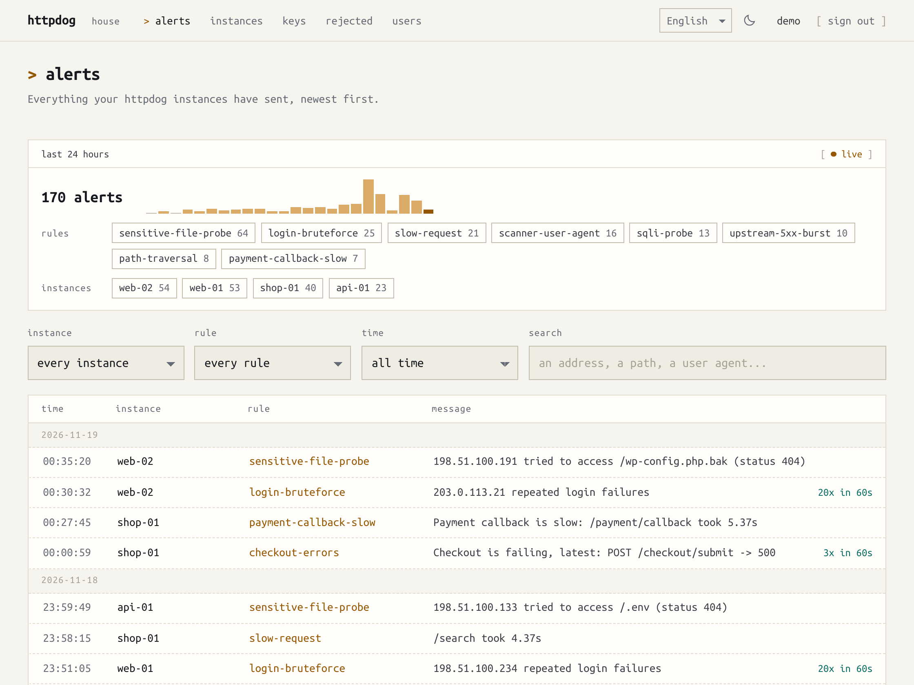
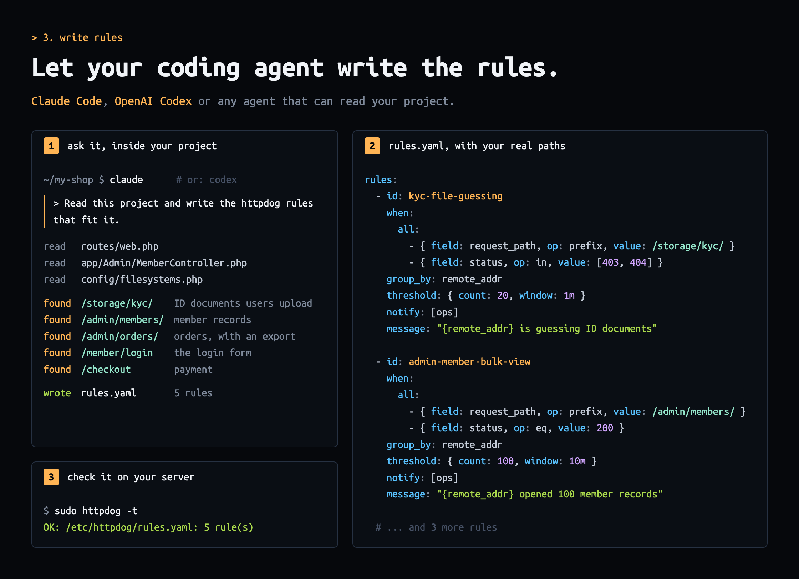

# httpdog

[](https://github.com/guanting112/httpdog/actions/workflows/build.yml)
[](https://github.com/guanting112/httpdog/releases/latest)
[](LICENSE)
[](https://github.com/guanting112/httpdog/attestations)
[](https://scorecard.dev/viewer/?uri=github.com/guanting112/httpdog)
[](https://www.bestpractices.dev/projects/16888)
[](#1-install-on-ubuntu)

- 🐕 **httpdog** (you are here): watches your website's access log and alerts you to suspicious or abnormal requests
- 🏠 [httpdog-house](https://github.com/guanting112/httpdog-house): collects the alerts from every server's httpdog into one searchable web page, on your own Cloudflare account

English | [繁體中文](README.zh-TW.md)


Watches your website's access log and notifies you when it sees suspicious or abnormal requests.

For example:

- Someone is scanning for sensitive files such as `/.env` or `/.git/config`
- The same IP fails to log in 20 times within a minute
- Someone is guessing the names of files your users uploaded: ID scans, PDFs, spreadsheets
- One address opens member records or orders in the admin area by the hundred
- The site suddenly returns a lot of 5xx, or some pages become very slow

You describe what should trigger a notification in a rule file. httpdog matches every log line nginx / Apache sends against it and notifies you on a match.

```
nginx / Apache ──a log line per request──▶ httpdog (matches the rules) ──▶ notification: your webhook URL, or the system log
```

- **Light**: a single binary (about 4 MB) using about 5 MB of memory when idle, with no database or other service to run
- **Fast**: written in Rust and compiled to machine code, with no garbage collector to pause it. Replaying a log on a laptop, it matches 250,000 to 500,000 lines a second depending on the rules, in about 6 MB of memory. A site would have to serve that many requests a second before httpdog fell behind
- **Memory-safe**: the text in an access log is chosen by whoever sends requests to your site, so the program that reads it must not be the weak point. Rust rules out the memory errors behind most such holes, httpdog has no `unsafe` code of its own (the compiler is set to refuse any), and its log parsers and rule engine are fuzzed on every push
- **Easy to install**: releases ship amd64 and arm64 binaries that run as downloaded, no Rust needed
- **Works without touching the web server config**: reads the default log format of nginx / Apache
- **No restart to change rules**: `systemctl reload` applies them; a broken new rule file keeps the old rules, so monitoring never stops
- **Notifications never slow down log intake**: a dead webhook does not affect matching

It only matches and notifies. It does not store logs and has no query interface; to look back through old logs, use a tool such as Loki or Graylog. To keep the alerts themselves and search them in a browser, pair it with [httpdog-house](#a-ready-made-receiver-httpdog-house):

<a href="https://github.com/guanting112/httpdog-house">
<picture>
  <source media="(prefers-color-scheme: dark)" srcset="docs/httpdog-house-dark.png">
  
</picture>
</a>

## Contents

1. [Install on Ubuntu](#1-install-on-ubuntu)
2. [Feed it logs](#2-feed-it-logs)
3. [Write rules](#3-write-rules)
4. [Receive notifications](#4-receive-notifications)
5. [Day-to-day operations](#5-day-to-day-operations)
6. [Troubleshooting](#6-troubleshooting)

Also: [Command line](#command-line), [More documentation](#more-documentation), [Development](#development)

## 1. Install on Ubuntu

Every [release](https://github.com/guanting112/httpdog/releases) ships prebuilt binaries for amd64 and arm64. They need no Rust and run on any Ubuntu version. The six steps below end with a request to your own site showing up as an alert.

```bash
# 1. The binary, from the latest release. dpkg prints amd64 or arm64
ARCH=$(dpkg --print-architecture)
curl -fsSLO "https://github.com/guanting112/httpdog/releases/latest/download/httpdog-linux-$ARCH"
curl -fsSLO https://github.com/guanting112/httpdog/releases/latest/download/SHA256SUMS
sha256sum --check --ignore-missing SHA256SUMS      # Should print httpdog-linux-...: OK
sudo install -m 755 "httpdog-linux-$ARCH" /usr/local/bin/httpdog
httpdog --version

# 2. The example rule file, the two systemd units and the nginx snippet, from the same version as the binary
RAW="https://raw.githubusercontent.com/guanting112/httpdog/v$(httpdog --version | cut -d' ' -f2)"
curl -fsSLO "$RAW/rules.example.yaml"
curl -fsSLO "$RAW/deploy/httpdog.service"
curl -fsSLO "$RAW/deploy/httpdog.socket"
curl -fsSLO "$RAW/deploy/nginx-snippet.conf"
sudo install -d /etc/httpdog
sudo install -m 644 rules.example.yaml /etc/httpdog/rules.yaml

# 3. Secrets (the webhook URL and secret), readable by root only
sudo install -m 600 /dev/null /etc/httpdog/secrets.env
sudoedit /etc/httpdog/secrets.env
```

`secrets.env` gets two lines. They say where alerts are sent and what they are signed with:

```
HTTPDOG_WEBHOOK_URL=https://<your receiver>/...
HTTPDOG_WEBHOOK_SECRET=<a value from openssl rand -hex 32>
```

**Nothing to receive alerts yet?** Write `http://127.0.0.1:9/none` as the URL and any secret, and go on. Every alert is also written to httpdog's log, which is where step 6 looks; the webhook just fails until you put a real one in ([section 4](#4-receive-notifications)).

```bash
# 4. Check the rule file, then hand httpdog to systemd
sudo httpdog -t                          # Should print OK: /etc/httpdog/rules.yaml: 4 rule(s)
sudo install -m 644 httpdog.service httpdog.socket /etc/systemd/system/
sudo systemctl daemon-reload
sudo systemctl enable --now httpdog      # Enables and starts httpdog.socket along with it

# 5. Have nginx send its access log to httpdog
sudo install -m 644 nginx-snippet.conf /etc/nginx/conf.d/httpdog.conf
sudo nginx -t && sudo systemctl reload nginx

# 6. See it work: ask your own site for a file the example rules watch, then read httpdog's log
curl -s -o /dev/null http://127.0.0.1/.env
journalctl -u httpdog -n 5
```

The log should have these two lines, the second being the alert (the status is whatever your site answers):

```
httpdog started: 4 rule(s), listening on unix:/run/httpdog/httpdog.sock (socket held by systemd)
ALERT [httpdog] sensitive-file-probe | 127.0.0.1 tried to access /.env (status 404) | remote_addr=127.0.0.1
```

**That log is where everything httpdog does shows up**: alerts, webhook failures, the result of a reload, and the reason when it does not start. `journalctl -u httpdog -f` follows it live. With the placeholder URL of step 3, each `ALERT` is followed by a few `webhook attempt N failed` lines; that is the fake URL, not a fault.

**No `ALERT`?** The usual reason is in step 5: a `server { }` block with an `access_log` line of its own does not use the one in `conf.d`. Add the `access_log syslog:...` line from `/etc/nginx/conf.d/httpdog.conf` inside that `server { }` block as well, and reload nginx. Other reasons are in [Troubleshooting](#6-troubleshooting).

Notes:

- To install a specific version instead of the latest, replace `latest/download` with `download/v0.3.0` in both URLs of step 1.
- `SHA256SUMS` only catches a corrupted download, because it sits next to the binaries. To prove that a binary was built by this repository's workflow, verify its signed build provenance. Each release carries it as `httpdog.sigstore.json`, so `gh` needs no GitHub login:

  ```bash
  curl -fsSLO https://github.com/guanting112/httpdog/releases/latest/download/httpdog.sigstore.json
  gh attestation verify "httpdog-linux-$ARCH" -R guanting112/httpdog --bundle httpdog.sigstore.json
  ```

- `sudo httpdog -t` checks `/etc/httpdog/rules.yaml` the way `nginx -t` checks nginx's configuration, and reads `secrets.env` itself. Run it after every change to the rule file, before a reload.
- There are two unit files: `httpdog.socket` is the socket logs arrive on, which systemd creates and keeps, and `httpdog.service` is the program. Because systemd holds the socket, restarting httpdog loses no log lines.
- `httpdog.socket` assumes nginx's workers run as the `www-data` group, as they do on Ubuntu and Debian. Elsewhere (Fedora and Rocky Linux use `nginx`), change `www-data` in `httpdog.socket` before step 4. Where SELinux is enforcing, which is the default on those two, there is one more step. Both are in [who can send logs](#who-can-send-logs). On RHEL and Rocky Linux `sudo` does not look in `/usr/local/bin`, so write `sudo /usr/local/bin/httpdog -t` there.
- Step 5 uses the JSON log format, which the example rule file needs. To leave nginx's log format alone, or for Apache, see [section 2](#2-feed-it-logs).
- The service needs no account created in advance (the unit file uses `DynamicUser`). systemd reads `secrets.env` as root before dropping privileges, so the service itself cannot touch that file.
- The rule templates under `examples/` are in the repository, not in the release: `git clone`, or download the Source code archive on the release page.

### Building from source

For a system the release has no binary for, or to run your own changes. Rust 1.85 or later is needed.

```bash
git clone https://github.com/guanting112/httpdog.git && cd httpdog
cargo build --release
./target/release/httpdog --version
```

To install that build, use `sudo install -m 755 target/release/httpdog /usr/local/bin/` in place of step 1 above; `rules.example.yaml` and the two unit files under `deploy/` are already in the clone.

## 2. Feed it logs

Step 5 of the install already connected nginx, with the JSON format. This section is for the other format, for Apache, and for the details. httpdog understands two log formats:

| | Option 1: the default format (`combined`) | Option 2: JSON |
|---|---|---|
| What changes on the web server | nginx gets one line | nginx gets a `log_format` block |
| Fields rules can use | A fixed 13, without the site name (`host`) and the processing time (`request_time`) | You decide; add whatever you want to match |
| Good for | Trying it out; Apache | Long-term use; rules such as slow requests or grouping by site |

### Option 1: the default format (combined)

The default access log of nginx and Apache looks like this, and httpdog reads it directly:

```
203.0.113.7 - - [11/Nov/2026:13:50:01 +0800] "GET /.env HTTP/1.1" 404 153 "-" "curl/8.5.0"
```

1. Write `format: combined` at the top of the rule file. `examples/00-combined-starter.yaml` is a starter rule file that works as it is.
2. Replay an existing log first; nothing needs to change:

   ```bash
   httpdog --stdin --config examples/00-combined-starter.yaml < /var/log/nginx/access.log
   ```

3. For live monitoring, add one line inside nginx's `http { }`, then run `sudo nginx -t && sudo systemctl reload nginx`:

   ```nginx
   access_log syslog:server=unix:/run/httpdog/httpdog.sock,tag=nginx,nohostname;
   ```

Apache connects differently; see [docs/log-format.md](docs/log-format.md#apache).

### Option 2: JSON

This is what step 5 of the install set up. `deploy/nginx-snippet.conf` goes inside nginx's `http { }`, which is where a file in `/etc/nginx/conf.d/` ends up; then `sudo nginx -t && sudo systemctl reload nginx`:

```nginx
log_format httpdog escape=json
    '{"remote_addr":"$remote_addr",'
    '"host":"$host",'
    '"request_method":"$request_method",'
    '"uri":"$uri",'
    '"request_uri":"$request_uri",'
    '"status":$status,'
    '"request_time":$request_time,'
    '"body_bytes_sent":$body_bytes_sent,'
    '"http_referer":"$http_referer",'
    '"http_user_agent":"$http_user_agent"}';

access_log syslog:server=unix:/run/httpdog/httpdog.sock,tag=nginx,nohostname httpdog;
```

**The field names in rules are the JSON keys here.** To match something else, add a key to `log_format` and rules can use it. httpdog adds one field of its own, `request_path`: the path the client asked for, without the query string. Match paths with it rather than with `uri`, which nginx changes when it hands a request to `index.php` or to an error page.

### Notes for both options

- An existing `access_log` that writes to a file can stay; several `access_log` lines may sit at the same level.
- **A `server { }` block with an `access_log` line of its own does not use the one in `http { }`.** nginx takes the lines of the innermost level that has any. For such a site, put the `access_log syslog:...` line inside its `server { }` block too, or it sends httpdog nothing.
- When the site is behind Cloudflare or another reverse proxy, set up nginx's `real_ip` first. Otherwise every log line has the proxy's IP as its source, and "each IP counted separately" turns into everyone counted together.

For the content and type of each field and what to watch out for, see [docs/log-format.md](docs/log-format.md).

### Who can send logs

httpdog believes every log line it receives, so it matters who is able to send one. By default logs arrive on a unix socket, `/run/httpdog/httpdog.sock`, and `httpdog.socket` opens it to root and nginx's group (`www-data`) only. Other programs on the machine cannot feed httpdog fake logs. httpdog itself is not in that group: systemd hands it the open socket, so it gains no access to the web server's files.

- **If nginx runs as another group**, change `www-data` in `/etc/systemd/system/httpdog.socket` to that group (`nginx` on Fedora and Rocky Linux), then run `sudo systemctl daemon-reload && sudo systemctl restart httpdog.socket && sudo systemctl reload nginx`.
- **If SELinux is enforcing** (the default on Fedora, RHEL and Rocky Linux), it does not let nginx write to the socket until you install the small policy file that ships with httpdog. It allows that one action and nothing else:

  ```bash
  curl -fsSLO "$RAW/deploy/httpdog-selinux.cil"      # RAW as set in step 2 of the install
  sudo semodule -i httpdog-selinux.cil
  ```

- **UDP still works**: write `listen: 127.0.0.1:5514` at the top of the rule file and use the same address in nginx. But every program that can reach the address can then send logs, so httpdog prints a warning each time it starts. Use it only when a unix socket is not possible.

Details are in [docs/log-format.md](docs/log-format.md#how-logs-reach-httpdog).

## 3. Write rules

The rule file is a YAML file (JSON works too); a complete example is in `rules.example.yaml`. The one below has a single rule: **notify when the same IP fails to log in 20 times within 60 seconds**.

```yaml
instance: web-01                  # Name of this httpdog instance; notifications carry it

notifiers:                        # Where notifications can go
  console:
    type: stderr                  # Writes to the system log; start with this while testing rules
  ops:
    type: webhook                 # Sends to your own receiver
    url_env: HTTPDOG_WEBHOOK_URL
    secret_env: HTTPDOG_WEBHOOK_SECRET

rules:
  - id: login-bruteforce          # Name of the rule
    when:                         # Condition: all three of these hold
      all:
        - { field: request_path, op: prefix, value: /login }
        - { field: request_method, op: eq, value: POST }
        - { field: status, op: in, value: [401, 403] }
    group_by: remote_addr         # Each IP is counted separately
    threshold: { count: 20, window: 60s }   # Notify only after 20 hits within 60 seconds
    cooldown: 10m                 # After notifying, stay quiet about the same IP for 10 minutes
    notify: [console, ops]        # Which notifiers to send to
    message: "{remote_addr} repeated login failures"
```

A rule is made of these parts:

| Key | Purpose |
|---|---|
| `when` | The condition. Each item says which log field to look at, how to compare and what to compare with. Combine them with `all` (every one holds), `any` (at least one holds) and `not` (negation) |
| `threshold` | How many hits within a period before notifying. Without it, a single hit notifies |
| `group_by` | Grouping: thresholds and cooldowns are tracked separately per value of this field, e.g. each IP on its own |
| `cooldown` | After a notification, the same group stays quiet for this long. 1 minute when not set |
| `notify` | Which notifiers to send to |
| `message` | The notification text; `{field}` is replaced with that log line's value |

Comparisons include equality, prefix, suffix, contains, regular expressions and numeric comparison. The full list and the details are in [docs/rules.md](docs/rules.md).

### Ready-made rule templates

There are 7 rule files under `examples/`. Each is a complete config that loads as it is.

| File | Scenario | What it catches |
|---|---|---|
| `00-combined-starter.yaml` | Starter (`combined` format) | 8 general rules that work without changing the log format. Writes to the system log only; no webhook needed |
| `01-security-probe.yaml` | Security probing | Sensitive files scanned or read, directory traversal, SQL injection probes, scanning tools, bursts of 404s |
| `02-auth-abuse.yaml` | Login and account abuse | Brute force, credential stuffing, password-reset abuse, mass sign-ups, API auth failures, clients that keep getting rate limited |
| `03-site-health.yaml` | Site health | 5xx surges, an unresponsive backend, a high error rate on one site, slow requests, failing health checks, clients disconnecting early |
| `04-traffic-surge.yaml` | Traffic anomalies | Site-wide peaks, one IP flooding, one endpoint being hammered, scripts and crawlers, very large responses |
| `05-critical-endpoints.yaml` | Business-critical paths | Checkout errors, failed or slow payment callbacks, unknown sources entering the admin area, delete operations in the admin area, surges of API client errors |
| `06-private-data.yaml` | Private files and customer data | Guessing the names of uploaded files (ID scans, contracts, spreadsheets), bulk downloads of documents, walking through record numbers, one address opening members or orders in the admin area in bulk, every export from the admin area |

The thresholds and paths in the templates are placeholders; replace them with your site's real numbers and paths. What to change in each file is in [docs/rules.md](docs/rules.md#using-the-rule-templates).

### Let a coding agent write them

Which paths are worth watching is different on every site, and it is all in your project's code. A coding agent such as Claude Code or OpenAI Codex can read it there: open the agent in your project and ask for the rules.



A prompt to start from:

```text
Write an httpdog rule file for this project and save it as rules.yaml.

How rules work:
https://raw.githubusercontent.com/guanting112/httpdog/main/docs/rules.md
https://raw.githubusercontent.com/guanting112/httpdog/main/docs/log-format.md
Examples: https://github.com/guanting112/httpdog/tree/main/examples

Read this project's routes, upload paths and admin pages, then write rules for what
deserves an alert here: guessing of uploaded files, bulk viewing or export of members
and orders in the admin area, login abuse, errors on the paths that make money.
The access log is in httpdog's JSON format. Use this project's real paths, match them
with request_path, and list the thresholds you had to guess.
```

Put the result in `/etc/httpdog/rules.yaml` and run `sudo httpdog -t` before `sudo systemctl reload httpdog`. The thresholds are the agent's guesses; set them against your real traffic.

## 4. Receive notifications

Notifications can go to two places, set under `notifiers` in the rule file:

- **`stderr`**: writes to the system log; read it with `journalctl -u httpdog`. Start with this while testing new rules.
- **`webhook`**: httpdog sends the alert as JSON in an HTTP POST to the URL you choose. Your own program receives it and decides whether to store, forward or display it.

What a webhook receives looks like this:

```json
{
  "source": "httpdog",
  "instance": "web-01",
  "version": 1,
  "kind": "rule",
  "rule": "login-bruteforce",
  "timestamp": 1794416274,
  "text": "[httpdog] login-bruteforce | 198.51.100.9 repeated login failures | 3x in 60s | remote_addr=198.51.100.9",
  "message": "198.51.100.9 repeated login failures",
  "group_by": "remote_addr",
  "group": "198.51.100.9",
  "hits": 3,
  "window_secs": 60,
  "dropped": null,
  "event": { "remote_addr": "198.51.100.9", "uri": "/login", "status": 401 }
}
```

Three things to know:

1. **A secret is required** (`secret_env`); httpdog will not start without one. httpdog signs every request with it, and your receiver verifies with the same secret. That is how you know a request really came from httpdog and was not forged.
2. **`instance` tells you which instance sent it.** When several httpdog instances send to the same receiver, give each a different `instance` in its rule file; it is `unknown` when not set.
3. **Failed deliveries are retried**: a 5-second timeout and 3 attempts in total. If all fail, the alert is written to the system log and given up.

For a description of every field, how to verify the signature and a receiver example you can adapt, see [docs/webhook.md](docs/webhook.md). It also shows how to [send a receiver three test alerts](docs/webhook.md#testing-your-receiver) from a sample log, without touching the installed service.

### A ready-made receiver: httpdog-house

If you would rather not write a receiver, [httpdog-house](https://github.com/guanting112/httpdog-house) is one made for httpdog, as a separate project. It verifies the signature of every alert, keeps the alerts of all your instances in one place, and shows them on web pages behind a login, where you can search and filter them. It runs on your own Cloudflare account (two Workers and a D1 database, deployed with one command), so you need a Cloudflare account with a domain of yours on it.

To connect an instance, make a key on its **keys** page that lists the instance's name; the page shows the two lines for `secrets.env`. The `instance` in the rule file has to be a name the key lists: alerts from a name no key lists are refused. The steps are in [its README](https://github.com/guanting112/httpdog-house#connect-an-httpdog).

## 5. Day-to-day operations

```bash
journalctl -u httpdog -f            # Follow the log (alerts, retries and reload results all show up here)
sudo httpdog -t                     # Check the rule file, like nginx -t
sudo systemctl reload httpdog       # Apply new rules
sudo systemctl restart httpdog      # After changing secrets.env, or installing a new version
sudo systemctl stop httpdog.socket httpdog      # Stop it for good
```

A restart loses no log lines. systemd holds the socket, not httpdog, so nginx stays connected, and the lines it sends while httpdog is away wait in the socket until it is back (a few hundred fit, see [docs/log-format.md](docs/log-format.md#the-unix-socket)). For the same reason, stopping httpdog alone does not keep it stopped: the next log line starts it again. Stop `httpdog.socket` with it.

**To change rules**: edit, check, reload. The same three steps as with nginx.

```bash
sudoedit /etc/httpdog/rules.yaml
sudo httpdog -t && sudo systemctl reload httpdog
journalctl -u httpdog -n 5          # Confirm that "rules reloaded" appears
```

- `sudo httpdog -t` prints `OK: /etc/httpdog/rules.yaml: 4 rule(s)`, or the mistake and where it is. It reads the webhook URL and secret from `/etc/httpdog/secrets.env` the way systemd does, which is why it needs `sudo`.
- To check a file before putting it in place: `sudo httpdog -t --config new-rules.yaml`.
- A reload with a broken rule file keeps the old rules, so a skipped check does not stop the monitoring. The reason is in the log.

**To see how often new rules would fire** before applying them, replay a recent log. The number of alerts fired is printed at the end:

```bash
httpdog --stdin --config new-rules.yaml < access.log
```

- A rule file with a webhook needs the two variables of `secrets.env` in the environment for this; `export` them first.
- The replay really sends the alerts that fire. To leave the receiver alone, change `notify` in the new rules to `console` only, and change it back once you are happy with them.

**Send one test line by hand** to confirm the whole path works (JSON format, with a rule that matches `/.env`):

```bash
sudo logger -u /run/httpdog/httpdog.sock -d -t nginx \
  '{"remote_addr":"192.0.2.1","request_method":"GET","request_uri":"/.env","status":404}'
```

`sudo` is needed because only root and nginx's group may write to the socket. Without it the command ends with `Permission denied`, which is the protection doing its job.

## 6. Troubleshooting

| Symptom | Likely cause |
|---|---|
| No alerts at all | The site's `server { }` block has an `access_log` line of its own, so it does not use the one for httpdog (add the line there too, see [notes for both options](#notes-for-both-options)); nginx's `server=` does not match `listen` in the rule file; nginx's workers are not in the group `httpdog.socket` opens the socket to (nginx's error log shows `Permission denied`), or SELinux is enforcing and the policy file is not installed (the same `Permission denied`), see [who can send logs](#who-can-send-logs); or the log format does not match `format` in the rule file (the summary at exit shows many `unparseable` lines) |
| The log shows `warning: listening on UDP ...` | `listen` in the rule file is a UDP address, and any program that can reach it can send httpdog fake logs. To get the unix socket back, undo the three places that name the UDP address: remove the `listen` line, put `ListenDatagram=/run/httpdog/httpdog.sock` back in `httpdog.socket`, and change nginx's `server=` to `unix:/run/httpdog/httpdog.sock`. Then run `sudo systemctl daemon-reload && sudo systemctl restart httpdog.socket && sudo systemctl reload nginx` |
| A reload says `reload failed, keeping the old rules: listen is now ...` | The rule file names another address than the socket systemd holds. A reload cannot move httpdog to another address, and with that rule file httpdog would not start after the next reboot. Change `listen` back; or, to really move, see [docs/log-format.md](docs/log-format.md#the-unix-socket) |
| Does not start: `config error: the socket systemd passed is not the one the rule file names` | `listen` in the rule file and `ListenDatagram=` in `httpdog.socket` name different addresses. Make them the same, then `sudo systemctl daemon-reload && sudo systemctl restart httpdog.socket`. With the default socket, the rule file needs no `listen` line at all |
| Does not start: `cannot listen on unix:/run/httpdog/httpdog.sock: a socket is already there and cannot be checked: Permission denied` | The unit files are the current ones but the binary is 0.2.3 or older, which does not know that systemd holds the socket. Install the binary of the same version as the unit files |
| Does not start: `cannot listen on unix:/run/httpdog/httpdog.sock: the directory /run/httpdog does not exist` | The unit file is the one from 0.1.0, which does not create that directory; 0.1.0 listened on UDP by default. Install the current `deploy/httpdog.service` and `deploy/httpdog.socket`, and point nginx at the socket |
| Does not start: `Unit httpdog.socket not found` | `httpdog.service` is the current one and `httpdog.socket` was not installed with it. Install both unit files from `deploy/`, then `sudo systemctl daemon-reload` |
| Does not start: `A dependency job for httpdog.service failed`, and `journalctl -u httpdog.socket` shows `Failed to resolve group` | nginx runs as another group on this system. Change `www-data` in `httpdog.socket`, see [who can send logs](#who-can-send-logs) |
| A rule should match but does not | The field name differs from the key in `log_format`; or the rule matches `uri`, which nginx replaces with `/index.php` or an error page, where `request_path` is needed (see [docs/log-format.md](docs/log-format.md#things-to-watch-out-for)) |
| Notified once and then nothing | Still within the `cooldown`, 1 minute by default |
| The log shows `killed by the OOM killer` and httpdog keeps restarting | httpdog reached the memory ceiling in the unit file (`MemoryMax=256M`). The cause is almost always a rule whose `group_by` is something a client chooses freely, such as the path, while a flood of distinct values arrives. Group by something with fewer values (`remote_addr`), shorten that rule's `window` and `cooldown`, or raise `MemoryMax`; see [docs/limits.md](docs/limits.md#known-limitations) |
| Stops right after starting and is not restarted | The rule file has an error (exit status 78); look at `journalctl -u httpdog -n 20`. While it is down, the first log line that arrives makes systemd try a few more times and then give up on `httpdog.socket` too, so after fixing the file run `sudo systemctl start httpdog && sudo systemctl reload nginx` |
| One IP trips everyone's threshold | nginx is behind a proxy, so every source IP is the proxy's; set up `real_ip` |
| The log shows `falling behind, ... dropped so far`, or you get an `overload` alert | Traffic exceeds the processing rate; check for a badly performing regex. The number in the log is the total since startup; the number in the alert is the count since the previous alert |

## Command line

```
httpdog [--config rules.yaml] [-t] [--stdin] [--version]

  -c, --config <file>  rule file, default ./rules.yaml
  -t, --check          check the rule file and exit, like nginx -t. Without --config it checks
                       /etc/httpdog/rules.yaml; variables the rule file refers to that are not
                       in the environment are read from /etc/httpdog/secrets.env
      --stdin          read logs from stdin instead of listening on a socket
  -V, --version        print the version (e.g. httpdog 0.3.0) and exit
```

`--stdin` has two uses:

1. **Replaying old logs to test rules**: `httpdog --stdin --config new-rules.yaml < access.log` prints the number of alerts fired at the end.
2. **Running behind another program**: for example an Apache pipe, or rsyslog's `omprog` (rsyslog receives syslog and starts httpdog; no unit file is needed in that case).

| Signal | Behavior |
|---|---|
| `SIGHUP` | Reload the rule file (this is what `systemctl reload` sends). A broken new file keeps the old rules and the reason is logged |
| `SIGTERM` / `SIGINT` | Send the notifications still waiting, then exit |

| Exit status | Meaning |
|---|---|
| 0 | Normal exit |
| 1 | Cannot listen on the address in `listen` |
| 2 | Invalid command-line arguments |
| 78 | Rule file error, which is also what `-t` exits with when the check fails. systemd does not restart it in this case (the unit file sets `RestartPreventExitStatus=78`) |

## More documentation

| Document | Content |
|---|---|
| [docs/rules.md](docs/rules.md) | The full rule file reference: every key, all operators, matching details, alerts when falling behind, notes on using the templates |
| [docs/log-format.md](docs/log-format.md) | The fields of both log formats, connecting Apache, adding fields |
| [docs/webhook.md](docs/webhook.md) | Every field of the webhook body, verifying the signature, a receiver example |
| [docs/limits.md](docs/limits.md) | Known limitations, and which parts have actually been verified and which have not |
| [docs/development.md](docs/development.md) | Development and releases: code layout, tests, CI |
| [CHANGELOG.md](CHANGELOG.md) | Changes in each version |
| [SECURITY.md](SECURITY.md) | How to report a vulnerability, and what counts as one |
| [CONTRIBUTING.md](CONTRIBUTING.md) | How to report a bug or propose a change, and the design rules |

## Development

```bash
make ci             # Format check, clippy, unit tests, example rule file checks, smoke tests; run before committing
make fuzz           # Fuzz the log parsers and the rule engine, every target at once, 60s each (FUZZTIME=300 for longer)
make                # List every target
```

Details are in [docs/development.md](docs/development.md).

## License

Released under the MIT License; see [LICENSE](LICENSE).
